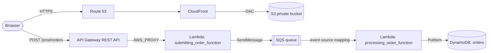

# AWS Serverless Order Processing

A fully serverless order system on AWS, built entirely with Terraform. A customer submits an order on a static website; the order is queued, then processed asynchronously and stored in a database.

**Stack:** Terraform · S3 · CloudFront · Route 53 · API Gateway · Lambda (Python 3.12) · SQS · DynamoDB · IAM

## Architecture

## Architecture


<details>
<summary>Editable Mermaid version</summary>



</details>

### How an order flows

1. The browser loads the order form from `https://zeyadbatis.com`. Route 53 points to CloudFront, which serves `index.html` from a private S3 bucket using Origin Access Control (OAC).
2. The form validates input and sends a `POST` with JSON (`productName`, `quantity`, `email`) to API Gateway. The browser first sends a CORS preflight `OPTIONS` request, which API Gateway answers itself with a mock integration.
3. API Gateway invokes `submitting_order_function`, which puts the order on an SQS queue and returns `200` straight away.
4. An event source mapping delivers queued orders in batches of up to 10 to `processing_order_function`.
5. The processing function writes each order to the DynamoDB `orders` table. The SQS `messageId` is used as `order_id`, so a redelivered message overwrites the same row instead of creating a duplicate.

### Why a queue?

The API responds fast because it never waits on the database. The queue absorbs traffic spikes and retries failures, so orders are not lost if processing is slow or fails.

## Project structure

```
.
├── frontend/
│   └── index.html                  # Order form (static site)
├── lambda/
│   ├── SubmitOrderFunction.py      # API -> SQS
│   └── ProcessOrderFunction.py     # SQS -> DynamoDB
└── terraform/
    ├── maint.tf                    # Providers, S3 backend, locals
    ├── variables.tf                # Input variables
    ├── terraform.tfvars            # Variable values
    ├── output.tf                   # API_URL, SQS_URL
    ├── dynamodb.tf                 # Orders table
    ├── sqs.tf                      # Queue + Lambda event source mapping
    ├── iam_role.tf                 # One least-privilege role per Lambda
    ├── lambda.tf                   # Zip packaging + both functions
    ├── api_gw.tf                   # REST API, /orders, CORS, deployment, stage
    ├── frontend.tf                 # S3, OAC, bucket policy, CloudFront
    └── route53.tf                  # DNS alias record
```

## Security design

- **Least-privilege IAM:** each Lambda has its own role. The submit role can only `sqs:SendMessage` to the one queue. The processing role can only read/delete from that queue and `dynamodb:PutItem` to the one table.
- **Private S3 bucket:** all public access is blocked. Only the CloudFront distribution can read objects (OAC with a source ARN condition).
- **HTTPS only:** CloudFront redirects HTTP to HTTPS using an ACM certificate.
- **Scoped Lambda permission:** API Gateway can invoke the submit function only for `POST /orders` on this API.
- **Encrypted, locked remote state:** S3 backend with encryption and native lockfile.

## Prerequisites

Terraform does **not** create these. They must exist before the first `apply`:

| Requirement | Notes |
|---|---|
| Terraform >= 1.10 | Needed for `use_lockfile` S3 state locking |
| AWS CLI with credentials | Configured for the target account |
| S3 state bucket | `zeyad-terraform-state-files` in `ap-southeast-2` (enable versioning) |
| Domain + Route 53 hosted zone | `zeyadbatis.com` |
| ACM certificate in `us-east-1` | Status `ISSUED` (CloudFront requires this region) |

## Deploy

```bash
cd terraform
terraform init
terraform fmt -check
terraform validate
terraform plan -out=tfplan
terraform apply tfplan
terraform output
```

The frontend currently contains the API URL as a constant. After the first apply, copy the `API_URL` output into `API_URL` in `frontend/index.html` and run `terraform apply` again to upload it.

## Test

```bash
# Submit an order
curl -X POST "$(terraform output -raw API_URL)" \
  -H 'Content-Type: application/json' \
  -d '{"productName":"Keyboard","quantity":2,"email":"me@example.com"}'

# Check it landed in DynamoDB
aws dynamodb scan --table-name orders --region ap-southeast-2

# Watch the logs
aws logs tail /aws/lambda/submitting_order_function --follow --region ap-southeast-2
aws logs tail /aws/lambda/processing_order_function --follow --region ap-southeast-2
```

If you change `index.html`, CloudFront may serve the cached copy. Invalidate it:

```bash
aws cloudfront create-invalidation --distribution-id <ID> --paths /index.html
```

## Clean up

```bash
cd terraform
terraform destroy
```

The state bucket, hosted zone and ACM certificate are not managed by this project and are left in place.

## Cost

Everything is pay-per-use (Lambda, API Gateway, SQS, DynamoDB on-demand, CloudFront `PriceClass_100`). With low traffic this is close to free. The Route 53 hosted zone is the main fixed monthly cost.

## Roadmap

- [ ] Pass queue URL and table name to Lambdas via environment variables (remove hardcoded values)
- [ ] Inject the API URL into the frontend with `templatefile()`
- [ ] Add a dead-letter queue and partial batch failure handling
- [ ] Set explicit Lambda timeouts and SQS visibility timeout
- [ ] Server-side input validation and correct 4xx/5xx status codes
- [ ] API throttling (usage plan) and optional WAF
- [ ] CloudWatch log groups with retention, plus alarms
- [ ] Extract a reusable Lambda module
- [ ] GitHub Actions pipeline (`fmt`, `validate`, `plan`, `apply`) using OIDC
- [ ] Separate dev and prod environments

## What I learned

Remote state and locking, provider aliases for multi-region resources, data sources, IAM least privilege, API Gateway REST API plumbing (including CORS), queue-based decoupling, CloudFront with Origin Access Control, and how Terraform detects change (`source_code_hash`, `etag`, deployment `triggers`).
